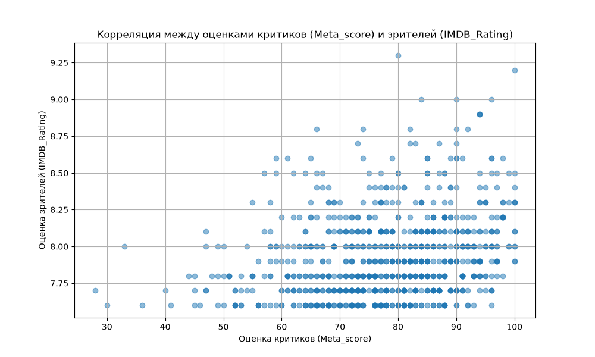

# Проект: IMDb Explorer (Анализ данных из топ-1000 фильмов по версии IMDb)

Этот проект представляет собой комплексный анализ данных о 1000 лучших фильмах по версии IMDb. Основная цель — продемонстрировать полный цикл работы с данными: от загрузки и очистки до глубокого анализа и визуализации результатов.

## 🚀 Ключевые Возможности

*   **Аудит Качества Данных:** Глубокая проверка на наличие дубликатов и пропущенных значений для обеспечения надежности анализа.
*   **Целевой Анализ:** Способность извлекать из общего набора данных конкретные срезы по заданным параметрам (на примере карьеры актера Уиллема Дефо).
*   **Проверка Статистических Гипотез:** Расчет коэффициента корреляции Пирсона для проверки связи между оценками критиков и зрителей.
*   **Наглядная Визуализация:** Построение диаграммы рассеяния с помощью Matplotlib для визуального подтверждения статистических выводов.

## 🛠️ Технологический Стек

| Компонент         | Технология  |
|:------------------|:------------|
| **Язык**          | Python 3.12 |
| **Анализ данных** | Pandas      |
| **Визуализация**  | Matplotlib  |
| **Работа с ОС**   | OS          |

## 🖇️ Разработка с ИИ-ассистентом

Проект реализован в тесном сотрудничестве с продвинутым ИИ-ассистентом (Gemini). Этот подход был выбран сознательно, чтобы продемонстрировать современный рабочий процесс, в котором специалист выступает в роли ведущего аналитика, а ИИ — в роли мощного инструмента для генерации кода, объяснения сложных концепций и совместного дебаггинга.

*   **Роль аналитика (человека):** Постановка задач, формулирование гипотез, проверка и отладка кода, интерпретация результатов и принятие финальных решений.
*   **Роль ИИ-ассистента:** Генерация кода по запросу, пошаговое объяснение синтаксиса и концепций, предложение альтернативных решений и помощь в поиске и устранении ошибок.

## ⚙️ Установка и Запуск

### 1. Клонирование репозитория
```bash
git clone https://github.com/kadence-init/imdb-top-1000-analysis.git
cd imdb-top-1000-analysis
```

### 2. Установка зависимостей
```bash
pip install pandas matplotlib
```

### 3. Запуск анализа
Проект представлен в виде Python-скрипта. Откройте и запустите файл `project_1.py` в вашей среде разработки.

## 📊 Анализ и Результаты

### Этап 1: Аудит и проверка качества данных
Любой серьезный анализ начинается с проверки целостности данных.

*   **Дубликаты:** Анализ выявил два фильма с одинаковым названием `Drishyam`. Расследование показало, что это не ошибка, а оригинал (2013) и ремейк (2015). Удаление не потребовалось.
*   **Пропущенные значения:** Обнаружены пропуски в колонках `Certificate` (101), `Meta_score` (157) и `Gross` (169), что было учтено на последующих этапах.

**Вывод:** Для разных этапов анализа будет применяться разная стратегия. Для целевого анализа (поиск актера) пропуски можно игнорировать, для корреляционного анализа строки с отсутствующими оценками будут исключены.

### Этап 2: Целевой анализ: Карьера Уиллема Дефо
Был дан ответ на вопрос: какие фильмы с участием актера Уиллема Дефо входят в топ-1000? Анализ показал, что Уиллем Дефо — актер с выдающейся карьерой, стабильно появляющийся в высокооцененных фильмах на протяжении более 30 лет и сотрудничающий с разными культовыми режиссерами.

| Series_Title          | Released_Year | IMDB_Rating | Meta_score | Director        |
|:----------------------|:--------------|:------------|:-----------|:----------------|
| Platoon               | 1986          | 8.1         | 92.0       | Oliver Stone    |
| Togo                  | 2019          | 8.0         | 69.0       | Ericson Core    |
| The Boondock Saints   | 1999          | 7.8         | 44.0       | Troy Duffy      |
| Mississippi Burning   | 1988          | 7.8         | 65.0       | Alan Parker     |
| The Florida Project   | 2017          | 7.6         | 92.0       | Sean Baker      |

### Этап 3: Проверка гипотезы и визуализация
Была проверена гипотеза: **"Существует значимая положительная корреляция между оценками критиков (`Meta_score`) и зрителей (`IMDB_Rating`)"**. Для проверки гипотезы был рассчитан коэффициент корреляции Пирсона и построена диаграмма рассеяния.



**Результаты и выводы:**

*   **Коэффициент корреляции составил `+0.27`**, что указывает на **слабую положительную связь**.
*   **Визуализация** подтвердила общий тренд (график движется из левого нижнего угла в правый верхний), однако облако точек оказалось широким и рассеянным, что указывает на частое расхождение мнений критиков и зрителей.

## 💡 Общий Вывод

Проект успешно демонстрирует владение ключевыми инструментами анализа данных (Python, Pandas, Matplotlib) для решения практических задач: от аудита и очистки данных до проверки гипотез и наглядной визуализации выводов.

## 📄 Источник данных

Данные взяты из публичного набора данных с платформы Kaggle: [IMDb Movies Dataset](https://www.kaggle.com/datasets/harshitshankhdhar/imdb-dataset-of-top-1000-movies-and-tv-shows).

## 📈 Планы по Развитию

- [ ] Заменить статический .csv файл на живые данные, получаемые по API.
- [ ] Построить пользовательский интерфейс (дашборд).
- [ ] Расширить набор аналитических метрик и срезов.
- [ ] Добавить предсказательную модель (Machine Learning), способную на основе существующих данных предсказать рейтинг IMDb для нового фильма.
