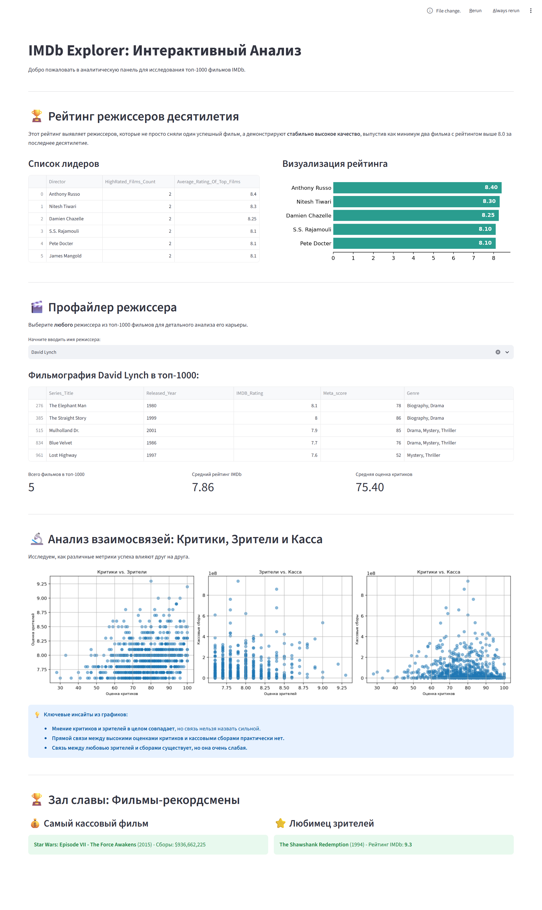

# Проект: IMDb Explorer — Интерактивный Аналитический Дашборд

Этот проект эволюционировал из простого скрипта в полноценный **интерактивный аналитический дашборд**, предназначенный для глубокого исследования данных о 1000 лучших фильмах по версии IMDb.

Цель проекта — продемонстрировать создание **end-to-end data-продукта**: от проектирования архитектуры и создания ETL-пайплайна до проведения многофакторного анализа и разработки интерактивного пользовательского интерфейса для презентации результатов.



## 🚀 Ключевые Возможности

*   **Модульная Архитектура:** Проект построен на принципах чистого кода с четким разделением ответственности (`config`, `main`, `dashboard_core`, `utils`), что обеспечивает масштабируемость и простоту поддержки.
*   **ETL-пайплайн:** Реализован процесс извлечения (из CSV), преобразования (очистка, типизация данных) и загрузки (в базу данных **SQLite**).
*   **Интерактивный Дашборд:** Пользовательский интерфейс, созданный с помощью **Streamlit**, позволяет в реальном времени взаимодействовать с данными.
*   **Глубокий Анализ:**
    *   Выявление **самых стабильно успешных режиссеров** последнего десятилетия с помощью сложных SQL-запросов.
    *   Исследование **корреляций** между оценками критиков, зрителей и кассовыми сборами.
    *   **Интерактивный "Профайлер"**, позволяющий получить детальную статистику по любому режиссеру из базы данных.
*   **Качественная Визуализация:** Использование Matplotlib для построения наглядных и эстетически выверенных графиков.

## 🛠️ Технологический Стек

| Компонент         | Технология  | Описание                                     |
|:------------------|:------------|:---------------------------------------------|
| **Язык**          | Python 3.12 | Основа проекта                               |
| **Анализ данных** | Pandas      | Обработка, очистка и трансформация данных    |
| **База данных**   | SQLite      | Хранение структурированных, очищенных данных |
| **Дашборд**       | Streamlit   | Создание интерактивного веб-интерфейса       |
| **Визуализация**  | Matplotlib  | Построение статических графиков и диаграмм   |

## 🖇️ Разработка с ИИ-ассистентом

Проект реализован в тесном сотрудничестве с продвинутым ИИ-ассистентом (Gemini). Этот подход демонстрирует современный рабочий процесс, в котором специалист выступает в роли **архитектора и ведущего разработчика**, а ИИ — в роли **мощного ко-пилота** для ускорения разработки, отладки и брейншторминга.

## ⚙️ Установка и Запуск

Запуск проекта максимально упрощен и оптимизирован:

### 1. Клонирование репозитория
```bash
git clone https://github.com/kadence-init/imdb-top-1000-analysis.git
cd imdb-top-1000-analysis
```

### 2. Установка зависимостей
Рекомендуется создать виртуальное окружение.
```bash
pip install -r requirements.txt
```

### 4. Запуск скрипта
После подготовки базы данных можно приступать к последнему шагу.
Запустите файл 'imdb_start.bat' (если вы на Windows) или 'imdb_start.sh' (если на macOS или Linux).
В вашем браузере автоматически откроется вкладка с дашбордом.

## 📊 Анализ и Результаты

Все результаты анализа представлены в интерактивном дашборде и включают:

*   **Рейтинг актуальных топ-режиссеров:** Динамически формируемый список режиссеров, показавших наилучшую стабильность качества (не менее 2 фильмов с рейтингом >8.0 за последнее десятилетие).
*   **Анализ корреляций:** Визуализация взаимосвязей между тремя ключевыми метриками успеха:
    *   **Критики vs. Зрители:** Мнения в целом совпадают, но связь слабая.
    *   **Критики vs. Касса:** Значимой связи не обнаружено.
    *   **Зрители vs. Касса:** Присутствует очень слабая положительная корреляция.
*   **"Зал славы":** Демонстрация фильмов-рекордсменов по кассовым сборам и зрительскому рейтингу.

## 💡 Общий Вывод

Данный проект успешно демонстрирует навыки создания полноценного аналитического приложения. Он охватывает весь спектр задач: от **программной архитектуры** и **инженерии данных (ETL)** до глубокого статистического анализа и, что самое главное, до **разработки user-friendly интерфейса** для представления сложных данных в простом и понятном виде.

## 📄 Источник данных

Данные взяты из публичного набора данных с платформы Kaggle: [IMDb Movies Dataset](https://www.kaggle.com/datasets/harshitshankhdhar/imdb-dataset-of-top-1000-movies-and-tv-shows).

## 📈 Планы по Развитию

- [ ] **Автоматизация ETL:** Переход от статичного CSV-файла к автоматизированному пайплайну (API, веб-скрапинг) для регулярного обновления данных.
- [ ] **Продвинутый UX:** Реализация продвинутой фильтрации, инструмента для сравнения и переход на интерактивные библиотеки для визуализации (Plotly, Altair).
- [ ] **Тестирование:** Внедрение юнит-тестов для ключевых утилит для гарантии стабильности и надежности кода.
- [ ] **Деплой:** Упаковка приложения в **Docker-контейнер** и развертывание на облачной платформе, чтобы сделать дашборд публично доступным.